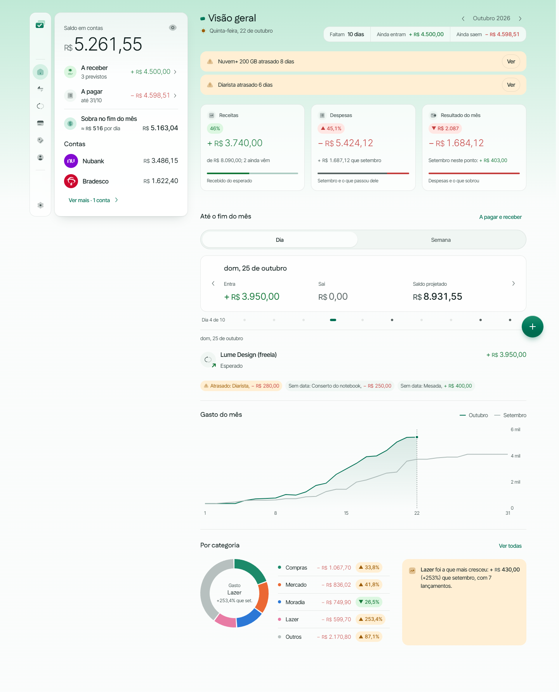
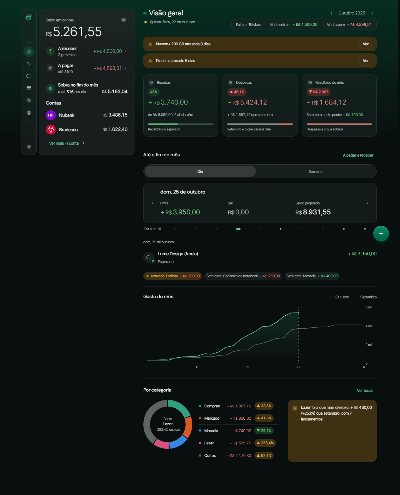
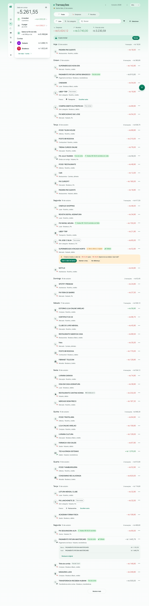
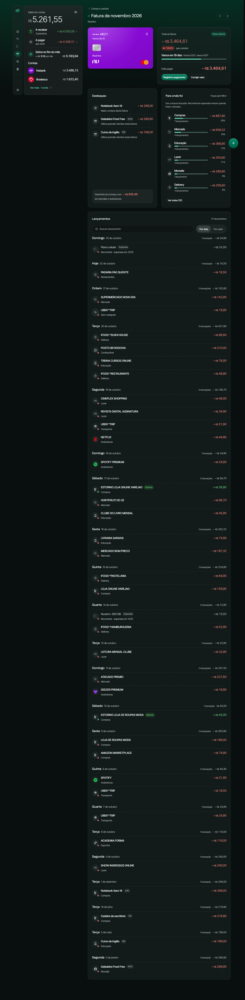
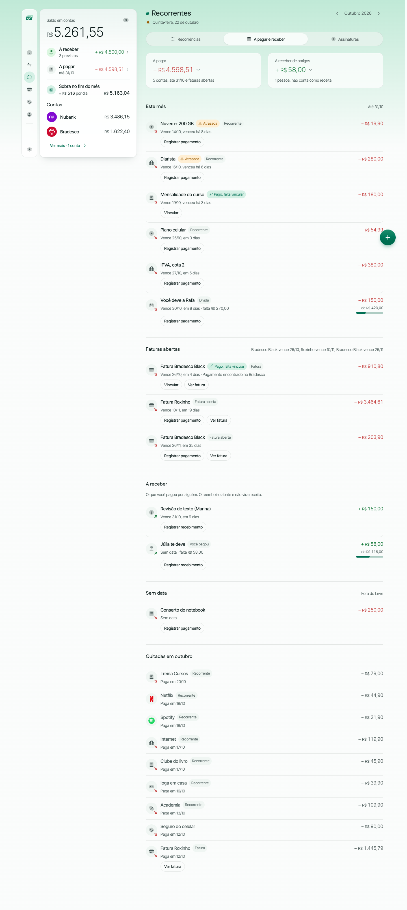
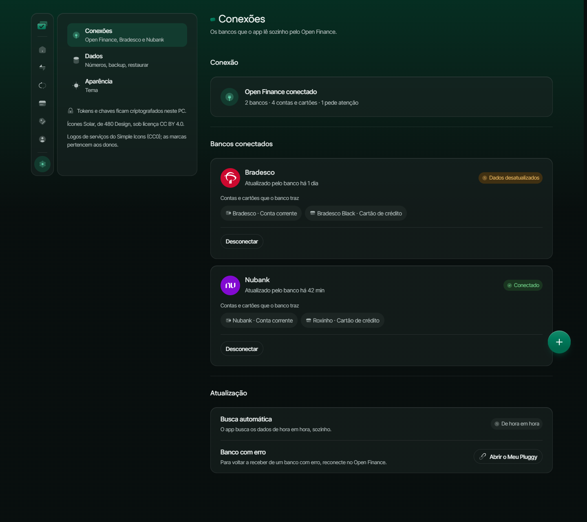

# Fincheck 2

A personal finance app that runs entirely on your own PC. It answers two questions without manual work: where did the money go, and how much can I still spend this month. Banks connect through Open Finance (via [Pluggy](https://pluggy.ai)); everything is stored in one local SQLite file. One user, no login, no hosting.

The interface is in Brazilian Portuguese and the currency is BRL.

<p align="center">
  
  
</p>

## What is inside

- **Overview:** free balance for the month, projection and spending by category.
- **Transactions, accounts and cards:** manual or imported from the bank, with categories, tags and rules.
- **Credit card invoices:** open, closed and paid, with installments.
- **Bills, recurrences and subscriptions:** what is due, what repeats, friend splits.
- **Settings:** bank connections (Pluggy), backup and restore, light and dark theme.

<p align="center">
  
  
</p>
<p align="center">
  
  
</p>

_Screenshots use mock data (`pnpm captures`)._

## Stack

TypeScript everywhere, in a pnpm monorepo.

| Folder            | Package            | What it is                                                                                |
| ----------------- | ------------------ | ----------------------------------------------------------------------------------------- |
| `apps/api`        | `@fincheck/api`    | [Hono](https://hono.dev) API and scheduled jobs; SQLite through Kysely and better-sqlite3 |
| `apps/web`        | `@fincheck/web`    | Vite, React 19, TanStack Router and Query, Tailwind v4, React Aria                        |
| `packages/shared` | `@fincheck/shared` | Zod schemas and types shared by API and web                                               |
| `packages/ui`     | `@fincheck/ui`     | Design system: tokens, fonts, components                                                  |

## Run locally

### Requirements

- **Windows 10 or 11.** This is the supported platform. macOS and Linux should run the app, but this is not tested, and saving the Pluggy keys does not work there (see [Pluggy](#connect-your-own-banks-pluggy)).
- **Git.**
- **pnpm 12.** The repository pins it in `packageManager`, so any recent pnpm (9.7 or newer) switches to the right version by itself. Install pnpm once, with either:
  - `winget install pnpm.pnpm`
  - or `npm install -g pnpm`, if you already have Node.
- **Node 26.13.0** is pinned in `.nvmrc`, but you do not need to install it: pnpm downloads it for the project and runs every script with it.
- `better-sqlite3` is a native module. It normally installs a prebuilt binary; if the install fails while compiling it, install the Visual Studio Build Tools ("Desktop development with C++") and run `pnpm install` again.

### Quick start

```powershell
git clone <repository-url> fincheck2
cd fincheck2
pnpm install
pnpm dev
```

`pnpm install` may print `Agent skills awaiting approval`; ignore it.

Then open **http://127.0.0.1:5173**. The first start creates and migrates the database, so the app opens empty, ready for you to add accounts by hand or connect a bank. To add accounts by hand, choose **Conta manual** in the Accounts > connect dialog (pick a bank from the list).

`pnpm dev` starts both apps:

| App        | Address                                           |
| ---------- | ------------------------------------------------- |
| Web (Vite) | `http://127.0.0.1:5173`                           |
| API        | `http://127.0.0.1:3333` (health check: `/health`) |

Both listen on `127.0.0.1` only. Stop with `Ctrl+C`. Run everything through `pnpm` (for example `pnpm exec ...`), never a bare `node`, so the pinned Node is used.

### Try it without the API (mock mode)

To look around with fake data, with no API, no database and no Pluggy:

```powershell
pnpm --filter @fincheck/web dev:mocks
```

Open http://127.0.0.1:5173. Changes you make are not saved.

### Configuration (optional)

The defaults work, so you can skip this. Without a `.env` the API prints `.env not found. Continuing without it.`; that is normal. To change the port, the database location or the token, copy the example file and edit it:

```powershell
copy apps\api\.env.example apps\api\.env
```

`apps/api/.env` is ignored by Git. Every variable is documented in [`apps/api/.env.example`](apps/api/.env.example):

| Variable        | Default            | What it does                             |
| --------------- | ------------------ | ---------------------------------------- |
| `API_PORT`      | `3333`             | API port. The web dev server follows it. |
| `DATABASE_FILE` | `data/fincheck.db` | SQLite file, relative to `apps/api`.     |
| `LOCAL_TOKEN`   | generated          | Token for the `X-Fincheck-Token` header. |

### Database

SQLite, in `apps/api/data/fincheck.db` (the folder is ignored by Git). There is nothing to run by hand: when the API starts it creates the file if missing and applies pending migrations. To back up, use the backup option in the app's settings, or copy the file with the API stopped. To start from scratch, stop the API and delete `apps/api/data`.

### Local token

Every API route except `/health` requires the `X-Fincheck-Token` header. You do not handle it: on the first start the API generates a token and saves it in `apps/api/data/local-token`, and the web dev server reads it and adds it to each `/api` request, so the browser never sees it. Only requests with the dev server's own `Host` and `Origin` get through.

### Connect your own banks (Pluggy)

Bank sync goes through Pluggy. It is optional: without it the app works with manual accounts and transactions. Each person uses their own Pluggy account and keys.

1. Sign up at the [Pluggy Dashboard](https://dashboard.pluggy.ai) and create an application. It gets a **Client ID** and a **Client Secret**. The secret is shown only once, so copy it right away.
2. Start the app (`pnpm dev`) and open **Configurações > Conexões** (Settings > Connections). Paste the Client ID and the Client Secret and save. The API checks them against Pluggy before storing them.
3. Get the Item ID (the 36-character connection code) from the Pluggy Dashboard:
   1. Connect your bank at [meu.pluggy.ai](https://meu.pluggy.ai).
   2. In the Dashboard, add the **MeuPluggy** connector to your application.
   3. Open the application and click "Ir para Demo".
   4. Authorize MeuPluggy (OAuth). This is done once per bank.
   5. In the Demo, open the three-dot menu (top right) and click "Copiar Item ID".

   > **Do this within the 15-day trial.** The trial starts when you create the Dashboard account. Connecting after it ends is not possible; already connected banks keep working.

   Sources: [pluggyai/meu-pluggy](https://github.com/pluggyai/meu-pluggy), [Actual Budget: Pluggy.ai](https://actualbudget.org/docs/advanced/bank-sync/pluggyai) (checked 2026-11-09).

4. In the app, go to **Contas** (Accounts), add an account, choose **Banco (Open Finance)** and paste the code. The accounts, cards and transactions are imported, and a job refreshes them every hour.

Notes:

- The keys are not in `.env`. They are stored in the database, with the secret encrypted by **Windows DPAPI** for your Windows user. That is why saving keys works only on Windows, and why a backup restored on another PC asks for the keys again.
- New Pluggy applications start with access to **Sandbox** connectors (fake banks), which is a safe way to try the flow. See the [Pluggy sandbox guide](https://docs.pluggy.ai/en/docs/guides/sandbox) for the test logins.
- Not confirmed from Pluggy's public documentation: pricing for connecting real banks after the trial. Check with Pluggy before relying on it.
- The Pluggy integration has so far been tested only against fake responses; expect rough edges with the first real bank.

## Commands

All from the repository root.

| Command                                 | What it does                                                                |
| --------------------------------------- | --------------------------------------------------------------------------- |
| `pnpm dev`                              | API and web together                                                        |
| `pnpm --filter @fincheck/web dev:mocks` | Web only, with mock data                                                    |
| `pnpm check`                            | Everything: Prettier, ESLint, Knip, TypeScript, tests (takes a few minutes) |
| `pnpm test`                             | Tests of every package (`pnpm --filter @fincheck/api test` for one)         |
| `pnpm format`                           | Format with Prettier                                                        |
| `pnpm captures <folder>`                | Screenshots of every screen, with mocks                                     |
| `pnpm --filter @fincheck/web build`     | Production build of the web app (there is no deploy)                        |

## Troubleshooting

- **Port 5173 is already in use:** the web port is fixed. Close the other Vite or Fincheck process using it.
- **API fails with `EADDRINUSE`:** set another `API_PORT` in `apps/api/.env`.
- **Wrong Node version, or a pnpm error about the runtime:** run scripts through `pnpm`, not `node`. Check that `pnpm --version` prints 12.x; if not, update pnpm and retry.
- **`pnpm install` fails on `better-sqlite3`:** see the build tools note in [Requirements](#requirements).
- **The web shows API errors right after the first start:** wait for the API to print `Fincheck API on http://127.0.0.1:3333` (the token file is written by then) and reload.
- **Do not use `pnpm install --force`:** it can break `node_modules` while a dev server is running.

## More

Repository rules (layers, naming, Git workflow) are in [`AGENTS.md`](AGENTS.md) and [`docs/naming-and-folders.md`](docs/naming-and-folders.md); both are in Portuguese.
